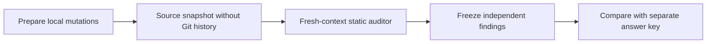
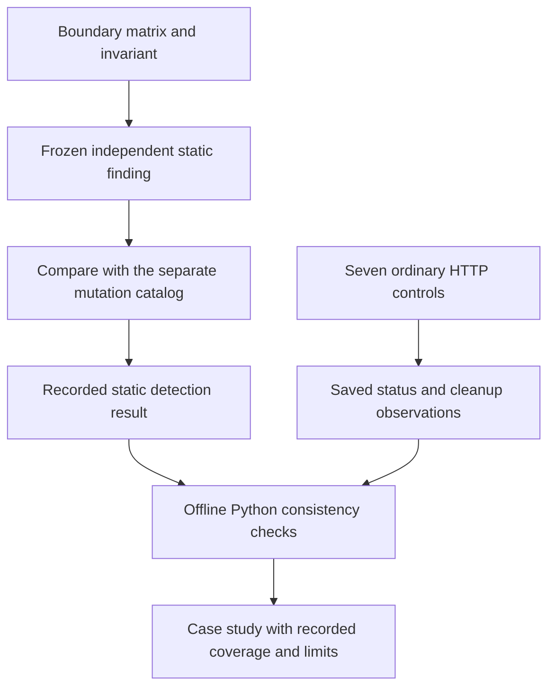
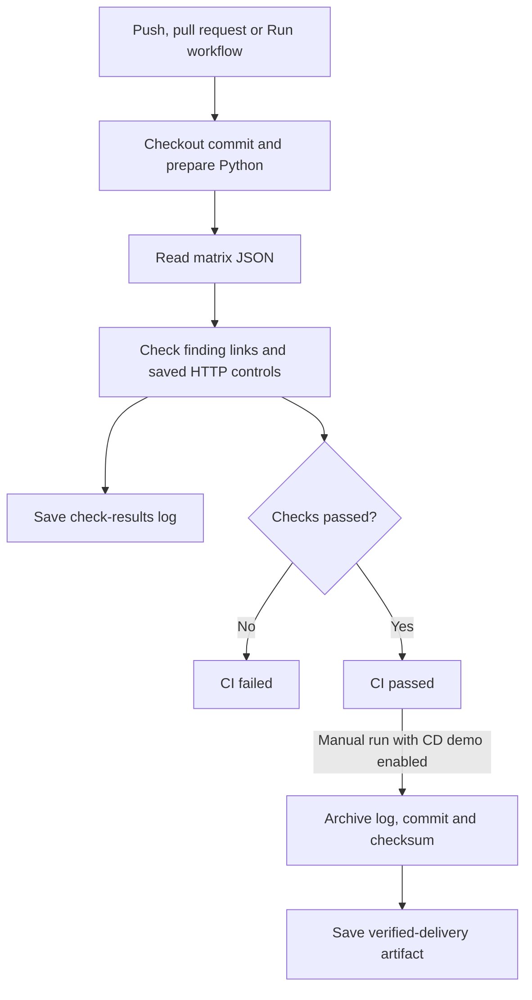

# FastAPI AppSec Mutation Benchmark

**Result: 5/5 deliberately seeded root causes identified by an independent static auditor. Exploit-level HTTP validation was not completed.**

Educational assessment of a local derivative of the [Full Stack FastAPI Template](https://github.com/fastapi/full-stack-fastapi-template/tree/f4bcfaba7c85be3c6332cc74a20819f586dcdbc6). All five defects were intentionally introduced. These are not upstream vulnerability discoveries.

| Deliberate mutation | OWASP API 2023 | Frozen finding |
| --- | --- | --- |
| JWT signature verification disabled | API2: Broken Authentication | [FA-001](evidence/blind-static.json#L4) |
| Item read ownership check removed | API1: Broken Object Level Authorization | [FA-004](evidence/blind-static.json#L125) |
| User directory role guard weakened | API5: Broken Function Level Authorization | [FA-002](evidence/blind-static.json#L45) |
| Administrator field accepted in self-profile updates | API3: Broken Object Property Level Authorization | [FA-003](evidence/blind-static.json#L80) |
| Password hash included in public responses | API3: Broken Object Property Level Authorization | [FA-005](evidence/blind-static.json#L160) |

Missed roots: **0**. Extra reported candidates: **0**. These counts describe one static attempt on one artificial snapshot.

## Where to start

| Open | What you will find |
| --- | --- |
| [Flow](#flow) | See how the auditor's findings were saved before comparison with the answer key. |
| [Testing pipeline](#testing-pipeline) | Follow the invariant-to-finding comparison and the separate normal HTTP controls. |
| [Benchmark index](benchmark.json) · [Boundary matrix](matrices/boundaries.json) | Match each seeded issue to an invariant and a saved finding. |
| [Comparison](evidence/comparison.json) · [HTTP controls](evidence/runtime-smoke.json) | Read the static detection result and the recorded normal HTTP checks. |
| [GitHub Actions](#github-actions) | Run consistency checks on the recorded benchmark results. |

## Boundaries, tests and evidence

The [boundary matrix](matrices/boundaries.json) links each invariant to its frozen static finding. [Python tests](tests/test_recorded_evidence.py) cross-check that mapping and the [seven recorded normal HTTP responses](evidence/runtime-smoke.json). The recorded runtime coverage applies to those normal requests. [Runtime status](evidence/runtime-status.json).

Run the offline evidence checks from the repository root with Python 3.10 or later.

```sh
python -B -m unittest discover -s tests -v
```

## Flow



## Testing pipeline

Each matrix row connects an expected security rule to a frozen static finding. The normal HTTP controls have their own saved observations.



| Part | Open |
| --- | --- |
| Rule and finding mapping | [Benchmark index](benchmark.json) and [boundary matrix](matrices/boundaries.json) |
| Static result and comparison | [Frozen audit](evidence/blind-static.json) and [comparison](evidence/comparison.json) |
| Normal HTTP observations | [Runtime controls](evidence/runtime-smoke.json) and [runtime status](evidence/runtime-status.json) |
| Current CI assertions | [Offline Python tests](tests/test_recorded_evidence.py) |

The five seeded defects belong to the recorded benchmark. Actions checks its saved data. Automatic mutation generation, mutation kill scoring and exploit-level validation remain outside the current workflow.

## GitHub Actions

Open [Case study checks](https://github.com/Keedz1Off/fastapi-appsec-mutation-benchmark/actions/workflows/checks.yml) and click **Run workflow**. CI reads the matrix JSON and checks the saved evidence offline. The run saves a `check-results` log. Select **CD demo** to also download `verified-delivery` with the log, commit SHA and checksum after checks pass.

### CI flow



### What happens in Actions

| Step | What it does |
| --- | --- |
| Checkout and Python | GitHub runs the selected commit on Ubuntu with Python 3.12. |
| Matrix JSON | CI requires the boundary index and reads every JSON file in the matrices folder. |
| Evidence tests | Two tests check the invariant-to-finding mapping and the seven saved normal HTTP controls. |
| Check log | CI uploads the result as `check-results`. |
| CD demo | After a passing manual run, CI saves the log, commit SHA and SHA-256 checksum as `verified-delivery`. |

[See the workflow file](.github/workflows/checks.yml). This job checks the material shipped in this repository offline.

## How to read

1. Start with the result table above.
2. Open [benchmark.json](benchmark.json): invariant, source location, finding ID, evidence and limits for each mutation.
3. Expand the evidence section for the frozen audit and measured controls.

<details>
<summary>Evidence and limitations</summary>

- [Frozen independent audit](evidence/blind-static.json), saved before comparison.
- [Mutation catalog](evidence/mutations.json) and [comparison results](evidence/comparison.json).
- [Seven normal HTTP controls](evidence/runtime-smoke.json): health, Alice/Bob login, own profile and own item. All returned 200; listener closed. These were not attack-validation tests.
- [Runtime status](evidence/runtime-status.json): automatic review stopped that worker before candidate-validation results. No equivalent retry was used.

The parent knew the mutations. The auditor received current code and a general behavior contract, with no seed list or count. Separation was by context and task restrictions, not an OS filesystem sandbox. The audited non-cache source snapshot remained unchanged.

Runtime used Python 3.14 and a SQLite/UUID adapter. PostgreSQL, frontend, real SMTP, deployment, load, full upstream suite and fixes were not tested. No mutation-test kill score or CI/Semgrep benchmark is claimed. The modified application remains local; this repository contains evidence, not a runnable reproduction.

Independent, AI-assisted educational work. Quoted upstream source retains its [MIT license](evidence/UPSTREAM-LICENSE.txt).

</details>

## Related security work

### AppSec

API authorization and invariant-based assessment: [FastAPI mutation benchmark matrix](benchmark.json).

### AI Agent Security

- [Browser Use](https://github.com/Keedz1Off/browser-use-agent-security-case-study) — navigation-policy boundaries.
- [FastMCP / MCP SDK](https://github.com/Keedz1Off/fastmcp-auth-state-sse-case-study) — authentication state and SSE error propagation.
- [Learn with GenAI](https://github.com/Keedz1Off/learn-with-genai-resource-lifecycle-case-study) — resource cleanup in a LangGraph application.

### Web3

[Web3 security case collection](https://github.com/Keedz1Off/web3-security-portfolio) and [Voxel Bench SR01](https://github.com/Keedz1Off/voxel-bench-sr01-case-study): smart-contract flows, invariants and author attribution.
