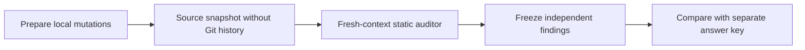

# FastAPI AppSec Mutation Benchmark

**Result: 5/5 deliberately seeded root causes identified by an independent static auditor. Exploit-level HTTP validation was not completed.**

Educational assessment of a local derivative of the [Full Stack FastAPI Template](https://github.com/fastapi/full-stack-fastapi-template/tree/f4bcfaba7c85be3c6332cc74a20819f586dcdbc6). All five defects were intentionally introduced. These are not upstream vulnerability discoveries.

| Deliberate mutation | OWASP API 2023 | Frozen finding |
| --- | --- | --- |
| JWT signature verification disabled | API2: Broken Authentication | [FA-001](evidence/blind-static.json#L4) |
| Item read ownership check removed | API1: Broken Object Level Authorization | [FA-004](evidence/blind-static.json#L125) |
| User directory role guard weakened | API5: Broken Function Level Authorization | [FA-002](evidence/blind-static.json#L45) |
| Administrator field accepted in self-profile updates | API3: Broken Object Property Level Authorization | [FA-003](evidence/blind-static.json#L80) |
| Password hash included in public responses | API3: Broken Object Property Level Authorization | [FA-005](evidence/blind-static.json#L160) |

Missed roots: **0**. Extra reported candidates: **0**. These counts describe one static attempt on one artificial snapshot.

## Flow

## How to read

1. Start with the result table above.
2. Open [benchmark.json](benchmark.json): invariant, source location, finding ID, evidence and limits for each mutation.
3. Expand the evidence section for the frozen audit and measured controls.

Evidence and limitations

- [Frozen independent audit](evidence/blind-static.json), saved before comparison.
- [Mutation catalog](evidence/mutations.json) and [comparison results](evidence/comparison.json).
- [Seven normal HTTP controls](evidence/runtime-smoke.json): health, Alice/Bob login, own profile and own item. All returned 200; listener closed. These were not attack-validation tests.
- [Runtime status](evidence/runtime-status.json): automatic review stopped that worker before candidate-validation results. No equivalent retry was used.

The parent knew the mutations. The auditor received current code and a general behavior contract, with no seed list or count. Separation was by context and task restrictions, not an OS filesystem sandbox. The audited non-cache source snapshot remained unchanged.

Runtime used Python 3.14 and a SQLite/UUID adapter. PostgreSQL, frontend, real SMTP, deployment, load, full upstream suite and fixes were not tested. No mutation-test kill score or CI/Semgrep benchmark is claimed. The modified application remains local; this repository contains evidence, not a runnable reproduction.

Independent, AI-assisted educational work. Quoted upstream source retains its [MIT license](evidence/UPSTREAM-LICENSE.txt).

